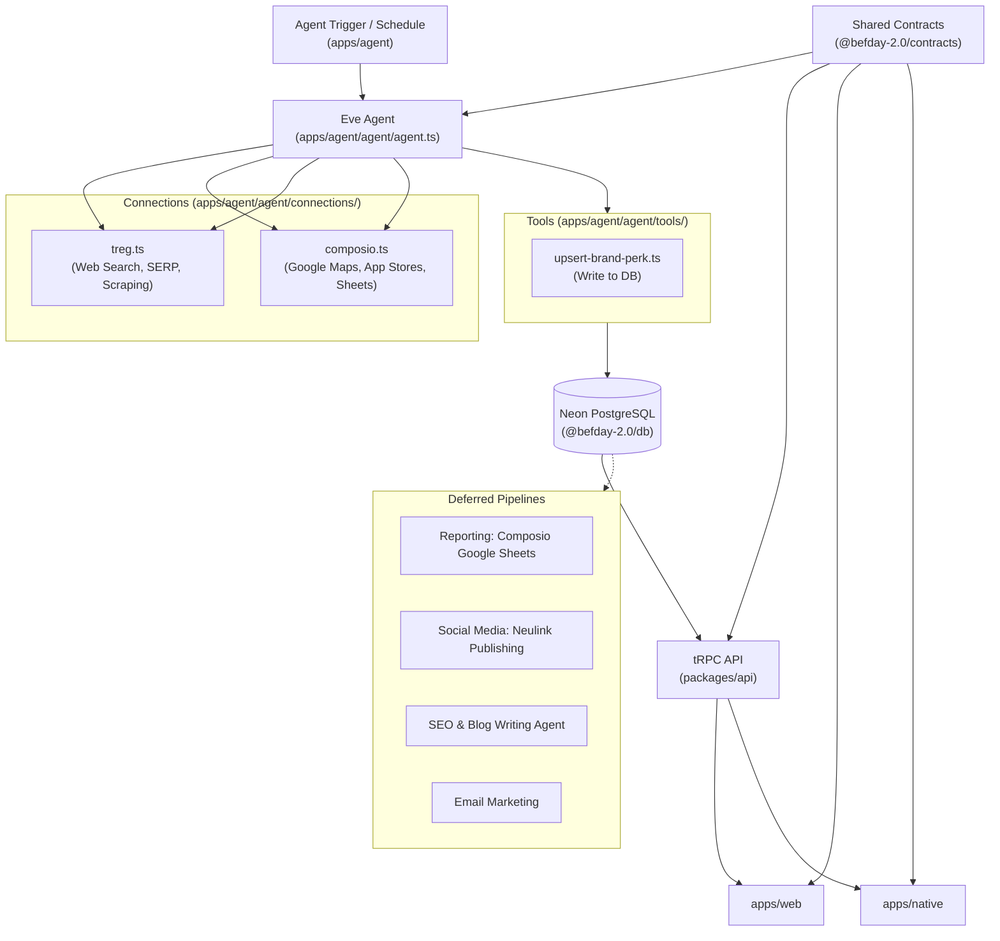
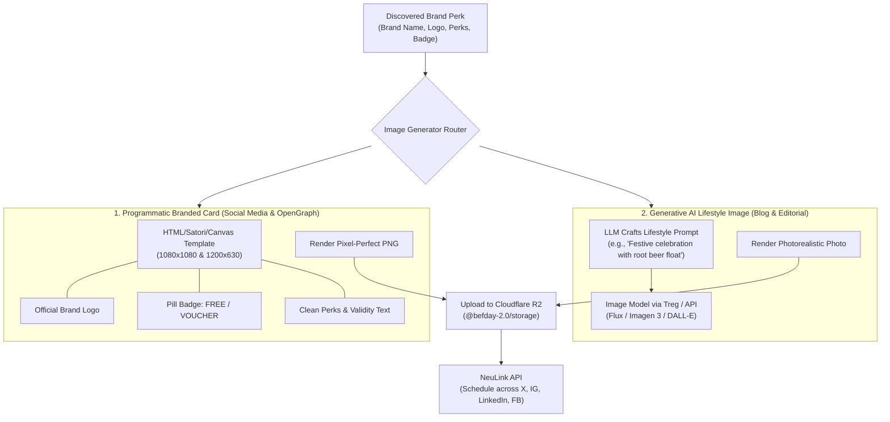

# Birthday Discovery Agent Implementation Plan

This plan details the design and implementation for the Birthday Discovery Agent in `apps/agent`, data modeling in `packages/db`, and API routing in `packages/api` based on the target birthday perk card:

- **Brand & Badge**: Name, short description, reward category (e.g. `Free`)
- **Action Links**: `[Location]` (Google Maps), `[App Store]` (iOS), `[Play Store]` (Android)
- **Birthday Perks**: Specific rewards list (e.g. `Free Root Beer`)
- **Validity**: Period (e.g. `Not specified`, `Birthday month`, `Birthday week`)
- **How To Redeem**: Instructions (e.g. `Via the mobile app`, `Show IC/ID`)

---

## 1. System Architecture



---

## 2. Eve Agent Blueprint (`apps/agent`)

### A. Connections

- **`apps/agent/agent/connections/treg.ts`** _(Configured)_:
  - Proxies Google Search and web scraping to fetch brand promotion/rewards pages, forum posts, and lifestyle blogs.
- **`apps/agent/agent/connections/composio.ts`** _(New)_:
  - Configures Composio MCP client for Google Maps Place resolution, Play Store/App Store search, and later Google Sheets sync.

### B. Tool (`apps/agent/agent/tools/`)

- **`upsert-brand-perk.ts`**:
  - Connects to `@befday-2.0/db` to create or update `Brand` and `BirthdayPerk` records directly in Neon PostgreSQL.
  - Consumes `upsertBrandPerkSchema` from `@befday-2.0/contracts`.
  - Derives `brandSlug` deterministically via `slugify`.
  - External search, app store link resolution, and Google Maps place lookups are performed directly by the agent via **Treg MCP** and **Composio MCP** connections.

### C. Instructions (`apps/agent/agent/instructions.md`)

- Defines standard operating procedures for verifying information:
  - Strict field consistency with the card UI.
  - Mark ambiguous or unconfirmed perks as `status: DRAFT`.
  - Store source URLs for auditability and verification.

---

## 3. Database Schema (`packages/db/prisma/schema/perk.prisma`)

Add new models to Neon PostgreSQL via Prisma:

```prisma
enum PerkBadge {
  FREE
  VOUCHER
}

enum PerkStatus {
  DRAFT
  PUBLISHED
  EXPIRED
  ARCHIVED
}

model Brand {
  id            String         @id @default(cuid())
  name          String
  slug          String         @unique
  description   String?
  logoUrl       String?
  websiteUrl    String?

  // External Action Links (matching UI card)
  googleMapUrl  String?
  appStoreUrl   String?
  playStoreUrl  String?

  createdAt     DateTime       @default(now())
  updatedAt     DateTime       @updatedAt

  perks         BirthdayPerk[]

  @@index([slug])
  @@map("brand")
}

model BirthdayPerk {
  id              String      @id @default(cuid())
  brandId         String
  brand           Brand       @relation(fields: [brandId], references: [id], onDelete: Cascade)

  badge           PerkBadge   @default(FREE)
  headline        String?     // e.g. "Discover exclusive birthday perks at A&W."
  perksList       String[]    // e.g. ["Free Root Beer"]
  validity        String      @default("Not specified")
  howToRedeem     String[]    // e.g. ["Via the mobile app"]
  termsConditions String?

  status          PerkStatus  @default(DRAFT)
  sourceUrls      String[]
  verifiedAt      DateTime?

  createdAt       DateTime    @default(now())
  updatedAt       DateTime    @updatedAt

  @@index([brandId])
  @@index([status])
  @@map("birthday_perk")
}
```

---

## 4. API Layer (`packages/api/src/routers/`)

Create modular tRPC routers:

1. **`perksRouter` (`packages/api/src/routers/perk.ts`)**:
   - `list`: Filter by badge (`FREE` / `VOUCHER`), search query, and pagination.
   - `bySlug`: Get complete brand + perk data for rendering the card.
   - `featured`: Curated or latest verified freebies.
2. **`agentRouter` (`packages/api/src/routers/agent.ts`)** _(Protected / Admin)_:
   - `triggerDiscovery`: Start agent run for a brand name.
   - `listDrafts`: View perks waiting for review.
   - `updateStatus`: Publish or edit draft perks.

---

## 5. Hybrid Image Generation & Social Publishing (NeuLink)

### A. The Hybrid Image Strategy



### B. Implementation Details

1. **Programmatic Branded Card Generator (`agent/tools/generate-brand-card.ts`)**:
   - Takes `{ brandSlug, name, logoUrl, badge, headline, perksList, validity }`.
   - Renders a clean card matching your target design in two standard aspect ratios:
     - **Square (1:1 / 1080x1080)**: Ideal for Instagram Feed & LinkedIn.
     - **Landscape (1.91:1 / 1200x630)**: Ideal for Twitter / X cards, OpenGraph, and Facebook.
   - Saves the generated buffer directly to Cloudflare R2 via `@befday-2.0/storage`.
   - Returns public CDN URL: `https://pub-2a9d4a23c4d0493f90df1732d01e5f6c.r2.dev/cards/[brandSlug].png`.

2. **Generative AI Lifestyle Image (`agent/tools/generate-lifestyle-image.ts`)**:
   - Generates contextual commercial photography (food, beverage, or retail celebration).
   - Strict rule: **No text in prompt** (prevents AI spelling distortions).
   - Uploads to Cloudflare R2: `https://pub-2a9d4a23c4d0493f90df1732d01e5f6c.r2.dev/lifestyle/[brandSlug].png`.

3. **Social Publishing Tool (`agent/tools/schedule-social-post.ts`)**:
   - Accepts `{ text, channels, mediaUrls, scheduledAt? }`.
   - Dispatches payload to NeuLink REST API (`https://api.neulink.com/v1/posts`).
   - Authenticates via `NEULINK_API_KEY`.

4. **Eve Skill (`agent/skills/social-publishing/SKILL.md`)**:
   - On-demand SOP for platform-specific copywriting:
     - **Twitter/X**: Punchy hook (< 280 chars), link to perk, `#BirthdayFreebies`.
     - **Instagram**: Emoji bullet points, redemption steps, "Link in bio" CTA.
     - **LinkedIn**: Consumer perk analysis and brand loyalty marketing angle.

---

## 6. Deferred Modules Roadmap

1. **Google Sheets Sync**:
   - Add `agent/tools/export-to-sheets.ts` using Composio Google Sheets tool to maintain a live QA sheet.
2. **SEO Discovery & Blog Subagent**:
   - Eve subagent in `agent/subagents/seo-writer/` for generating localized blog posts and programmatic landing pages with the AI lifestyle images.
3. **Email Marketing**:
   - Cloudflare Email / Resend integration for weekly birthday month digests.

---

## 6. Execution Order

- **Step 1**: Write `packages/db/prisma/schema/perk.prisma`, run `prisma generate` and migration.
- **Step 2**: Create `apps/agent/agent/connections/composio.ts` and discovery tools in `apps/agent/agent/tools/`.
- **Step 3**: Update `apps/agent/agent/instructions.md` with birthday perk extraction rules.
- **Step 4**: Create tRPC routers in `packages/api` and expose to web/native.
- **Step 5**: Test discovery flow end-to-end on target brands (e.g., A&W, Starbucks).
